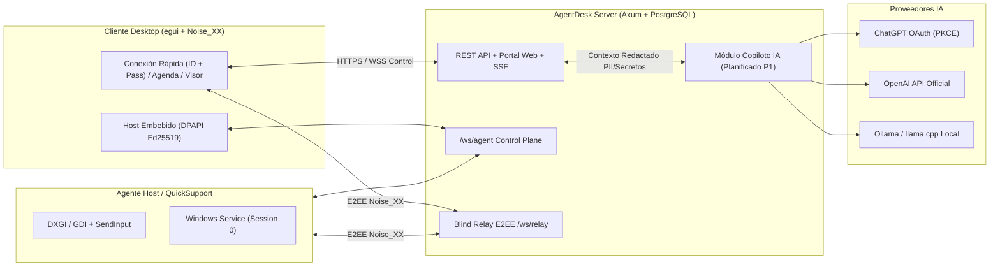

# AgentDesk (`agentdesk://`) — Plataforma de Soporte Remoto Inteligente Self-Hosted

**AgentDesk** es una plataforma **self-hosted, multiempresa y 100% desarrollada en Rust** concebida como alternativa profesional a TeamViewer, AnyDesk y RustDesk, integrando acceso desatendido, soporte puntual bajo demanda, agenda de clientes, portal web unificado, RMM y un **Copiloto de IA para soporte e inspección de máquinas vía ChatGPT OAuth**.

> **Estado actual:** Prototipo funcional completo de extremo a extremo compilado en Rust (`11/11` tests unitarios y de integración PostgreSQL aprobados), servicios nativos de Windows (SCM), cliente dual con **ID numérico + contraseña aleatoria** y consola gráfica de servidor con ícono en **Systray**.

---

## Tabla de Contenidos

1. [Qué tenemos implementado hoy](#-qué-tenemos-implementado-hoy)
2. [Arquitectura del Cargo Workspace](#-arquitectura-del-cargo-workspace)
3. [Integración de IA y Copiloto vía ChatGPT OAuth](#-integración-de-ia-y-copiloto-vía-chatgpt-oauth)
4. [Todos los Módulos del PRD Maestro y Roadmap (`M0`–`M4`)](#-todos-los-módulos-del-prd-maestro-y-roadmap-m0m4)
5. [Inicio Rápido (Build, Tests y Ejecución en Windows)](#-inicio-rápido-build-tests-y-ejecución-en-windows)
6. [Investigación REA y Decisiones de Arquitectura (ADR)](#-investigación-rea-y-decisiones-de-arquitectura-adr)

---

## ✅ Qué tenemos implementado hoy

### 1. Servidor Central, Portal Web y Relay E2EE (`agentdesk-server.exe`)
- **Control Plane + Blind Relay en Axum + SQLx (PostgreSQL):**
  - Portal público y consola web embebida: `/`, `/downloads`, `/support`, `/setup`, `/login`, `/app`.
  - API REST versionada `/api/v1/*`: setup/bootstrap, autenticación con sesiones revocables y cookies `HttpOnly`, tokens de enrolamiento expirables/revocables, inventario de dispositivos, **Agenda de Clientes Agendados**, cola de tickets con reclamo atómico (`claim`), registro instantáneo de clientes (`POST /api/v1/clients/register`), rotación de contraseña (`POST /api/v1/clients/password`), conexión directa por ID (`POST /api/v1/sessions/connect-by-id`), auditoría append-only UTC y eventos en tiempo real vía SSE (`/api/v1/events`).
  - WebSockets: canal de control de agentes (`/ws/agent`) y **relay ciego E2EE** (`/ws/relay/{session_id}`) que reenvía paquetes binarios cifrados sin capacidad de descifrado en el servidor.
- **Autodetección LAN y Servicio de Windows (SCM):**
  - Detecta automáticamente la IP LAN saliente y la publica en `/health/ready` y `/api/v1/setup/status`.
  - Configuración persistente (`agentdesk-server.json` / `%PROGRAMDATA%\AgentDesk\server_config.json`) con auto-seed configurable del administrador inicial.
  - Ejecución nativa como **Servicio Windows (`AgentDeskServer`)** mediante `--service` (`windows-service`) con parada limpia (`Stop`/`Shutdown`) y logs persistentes.

### 2. Consola del Servidor + Windows Systray (`agentdesk-server-console.exe`)
- Aplicación gráfica en `egui` con **ícono en el área de notificaciones (Systray)** de Windows y menú contextual (**Abrir Consola**, **Abrir Portal Web**, **Iniciar/Reiniciar**, **Detener**, **Configurar Firewall UAC**, **Salir y Detener**).
- Detecta si ya existe una instancia/servicio activo en el puerto configurado o lanza `agentdesk-server.exe` en segundo plano capturando sus **logs en vivo**.
- Incluye botones integrados con elevación UAC para habilitar reglas de Firewall (`allow-firewall.ps1`, perfiles `Any`) e instalar el servicio Windows (`install-server-service.ps1`).

### 3. Cliente Desktop Dual (`agentdesk-desktop.exe`)
- Basado en **Rust puro (`egui + eframe + AccessKit`, renderer OpenGL `Glow` por defecto con fallback automático a `Wgpu`)** y logging diagnóstico en `%LOCALAPPDATA%\AgentDesk\desktop.log`.
- **Conexión instantánea por ID y Contraseña (sin login obligatorio al abrir):**
  - Al iniciar carga su identidad criptográfica DPAPI (`Ed25519`), obtiene un **ID numérico estable de 9 dígitos (`XXX XXX XXX`)**, genera una **contraseña aleatoria CSPRNG de 8 caracteres** (hasheada con Argon2id en el servidor) y permanece listo en `/ws/agent`.
  - Permite **rotar la contraseña**, copiar credenciales en 1 clic, aceptar conexiones entrantes con **botón rojo inmediato "Cortar control remoto"**, o conectarse a otro cliente ingresando **ID + Contraseña** (modo **Control total** o **Solo ver**) a través de túnel **E2EE `Noise_XX` (`25519 + ChaChaPoly + BLAKE2s`)**.
- **Estética personalizable:**
  - **OpenVMS Claro** *(predeterminado)*: paleta clara técnica de alto contraste y tarjetas limpias.
  - **Dracula Oscuro**: paleta completa `#282A36` / `#BD93F9` / `#8BE9FD` / `#50FA7B`.
- **Consola técnica integrada:** pestañas de **Conexión Rápida**, **Clientes Agendados**, **Equipos con Agente**, **Cola de Soporte**, **Visor Remoto** (canvas hardware + FPS/RTT/BW + control de mouse + ajuste de calidad JPEG + chat) y **Configuración** (URL del servidor persistente, prueba de conexión `/health/ready`, presets LAN/Localhost y selector de tema).

### 4. Agente Host Desatendido y QuickSupport (`agentdesk-host.exe`)
- **Captura DXGI Desktop Duplication** (`IDXGIOutputDuplication` con soporte `OpenInputDesktop`/`SetThreadDesktop`) + fallback automático **GDI `BitBlt`**, inyección `SendInput` y telemetría de RAM privada (`GetProcessMemoryInfo`).
- Modo **Host desatendido**: identidad `Ed25519` cifrada con Windows **DPAPI**, configuración persistente (`host_config.json`, `--configure-server`, `--show-config`), reconexión automática cada `5s` y soporte nativo como **Servicio Windows (`AgentDeskHost`)** vía `--service`.
- Modo **QuickSupport (`--mode quicksupport`)**: ejecución efímera con cero persistencia en disco ni instalación de servicio, vinculado a código de soporte web.

---

## 🧱 Arquitectura del Cargo Workspace

| Crate / App | Tipo | Responsabilidad |
| :--- | :--- | :--- |
| `crates/protocol` | Lib | DTOs REST (`/api/v1/*`), mensajes de control `/ws/agent` y protocolo binario E2EE `DataPacket` (`bincode`). |
| `crates/identity` | Lib | Identidades `Ed25519` protegidas con Windows DPAPI, hashing `Argon2id`, tokens CSPRNG y túnel cifrado `Noise_XX_25519_ChaChaPoly_BLAKE2s` con fragmentación multi-chunk. |
| `crates/capture` | Lib | Captura Windows DXGI Desktop Duplication + fallback GDI, codificación/decodificación JPEG & LZ4, inyección de input y telemetría de memoria privada. |
| `crates/transport` | Lib | `RelayTunnel` sobre WebSockets (`tokio-tungstenite`) + cifrado extremo a extremo `Noise_XX`. |
| `apps/server` | Bin/Lib | Servidor central Axum + PostgreSQL, migraciones, portal web, relay ciego y soporte de Servicio Windows SCM (`AgentDeskServer`). |
| `apps/server-console` | Bin | Consola gráfica de administración del servidor + Systray en Windows + gestión UAC de Firewall y Servicio. |
| `apps/agent-host` | Bin | Agente residente Windows (`AgentDeskHost` SCM), benchmark DXGI/GDI y ejecutable portable `--mode quicksupport`. |
| `apps/desktop` | Bin | Cliente gráfico unificado (`OpenVMS Claro` / `Dracula Oscuro`), visor remoto, agenda de clientes, cola de soporte y modo dual ID + Contraseña. |



---

## 🤖 Integración de IA y Copiloto vía ChatGPT OAuth

Uno de los pilares estratégicos del PRD (`AI-01`..`AI-06`) es dotar al técnico y al administrador de un **Copiloto de Soporte Remoto** capaz de **ver máquinas, analizar telemetría y asistir en la resolución de incidentes en tiempo real**.

### Cómo funcionará en AgentDesk

1. **Autenticación flexible (`ChatGPT OAuth` + API + Modelos Locales) (`AI-01`, `AI-02`):**
   - **ChatGPT OAuth (OAuth 2.0 + PKCE):** el técnico o la organización podrá vincular su sesión autorizada de ChatGPT desde el portal o cliente nativo (sujeto a elegibilidad oficial de cuenta/proveedor), usando tokens delegados con scopes mínimos y revocables.
   - **Fallback oficial y soberano:** soporte nativo para **OpenAI API** (clave por tenant) y modelos locales on-premise (**Ollama** / **`llama.cpp`**) para entornos sin salida a Internet. La plataforma sigue operando al 100% si el módulo IA está desactivado.
2. **Inspección asistida de máquinas y pantallas (`AI-03`, `RMM-01..03`):**
   - El técnico podrá pedir en lenguaje natural: *"revisa por qué esta PC está lenta"*, *"verifica los servicios caídos de AgentDesk o PostgreSQL"* o *"analiza esta ventana de error"*.
   - Bajo consentimiento explícito, el agente recopila **lectura diagnóstica estructurada** (CPU, RAM, disco, procesos, servicios Windows, Event Viewer acotado, conectividad y captura de pantalla puntual) para que la IA diagnostique la causa raíz y proponga pasos concretos.
3. **Privacidad estricta y redacción previa (`AI-03`, `SEC-04`):**
   - Motor local de **redacción de secretos y PII** antes de salir hacia cualquier proveedor externo (enmascaramiento de tokens, claves DPAPI, contraseñas de sesión, IPs privadas sensibles o datos de clientes según política del tenant).
4. **Niveles progresivos de autorización (`AI-04`):**
   - `Nivel 1 — Consulta`: preguntas sobre tickets, inventario y base de conocimiento.
   - `Nivel 2 — Lectura diagnóstica`: recolección de métricas, logs acotados, estado de red/servicios y capturas autorizadas.
   - `Nivel 3 — Propuesta`: generación de scripts PowerShell/CMD o acciones explicadas con nivel de riesgo.
   - `Nivel 4 — Ejecución aprobada`: el técnico aprueba explícitamente cada comando antes de ejecutarse en el endpoint, quedando todo trazado en `audit_events`.
   - `Nivel 5 — Automatización acotada & MCP propio (P2, AI-06)`: servidor **MCP (Model Context Protocol)** de AgentDesk para agentes externos con identidad delegada, permisos granulares y aprobación humana fuera del modelo.
5. **Documentación automática de cierre (`AI-05`):**
   - Resumen automático de sesiones de soporte, borrador de notas de resolución del ticket y generación de artículos para la Base de Conocimiento (KB).

---

## 📋 Todos los Módulos del PRD Maestro y Roadmap (`M0`–`M4`)

Leyenda: `✅ Implementado (Prototipo funcional)` · `🚧 Parcial / En evolución` · `📋 Planificado (PRD)`

### Hito M0 — Investigación REA, Seguridad y Arquitectura *(Completado)*
- `✅` **`RES-01..04` Laboratorio REA:** inspección estática y de servicios sobre `TeamViewer 15.83.7.0` (`evidence.md`, `features.md`, `workflows.md`, `ui.md`, `performance.md`, `services-and-id-flow.md`).
- `✅` **`M0-MAT` / `M0-SEC`:** matriz competitiva ([research/feature-matrix.md](research/feature-matrix.md)), revisión legal de licencias ([research/license-review.md](research/license-review.md)), modelo de amenazas ([docs/security/threat-model.md](docs/security/threat-model.md)) y 5 ADRs aprobados (`docs/adr/`).
- `✅` **`M0-PROTO`:** benchmark real en Windows x64 (`DXGI Desktop Duplication` en `2560×1440`, `20.3 FPS` JPEG en prototipo inicial, `33.42 MB` RAM privada en Host inactivo).

### Hito M1 — Fundaciones, Identidad y Portal Web (`P0`)
- `🚧` **`OPS-01..03` Empaquetado e instalación:** scripts PowerShell para Servicio Windows SCM (`AgentDeskServer` y `AgentDeskHost`), Firewall multi-perfil y Docker PostgreSQL listos; pendiente instalador MSI firmado y empaquetado Linux `.deb`/systemd.
- `🚧` **`IAM-01..04` Usuarios, Multi-Tenancy y Agenda:** bootstrap/auto-seed admin, Argon2id, aislamiento por organización verificado con tests negativos y **Clientes Agendados** funcionales; pendiente UI completa de 7 roles RBAC, MFA TOTP e importación/exportación CSV.
- `🚧` **`WEB-01..05` Portal Público y Descargas:** rutas `/`, `/downloads` (SHA-256 reales de binarios locales), `/support`, `/setup`, `/login`, `/app` operativas; pendiente editor de branding y páginas `/docs` editables desde administración.
- `📋` **`REL-01` Dashboard de Releases:** carga CI, verificación Ed25519 y canales estable/beta.

### Hito M2 — Motor Remoto MVP y Asistencia Web E2E (`P0`)
- `✅` **`SEC-01` Identidad y E2EE:** claves `Ed25519` protegidas con DPAPI y canal `Noise_XX` validado con tests de rechazo ante alteración.
- `✅` **Conexión Directa ID + Contraseña:** generación automática de ID `XXX XXX XXX` + contraseña aleatoria CSPRNG al abrir `agentdesk-desktop.exe`.
- `🚧` **`ENG-01..03` Captura y Control:** DXGI + GDI fallback, `SendInput` mouse/teclado y cambio de escritorio (`OpenInputDesktop`/`SetThreadDesktop`); pendiente códec hardware **H.264 Media Foundation**, audio **WASAPI/Opus**, portapapeles sincronizado, multimonitor explícito y manifest `uiAccess="true"` para prompts UAC.
- `🚧` **`ENG-04..05` Transporte y Sesión:** conexión directa LAN/WAN vía WebSocket + Relay E2EE ciego, chat en sesión y calidad JPEG dinámica; pendiente **QUIC + NAT traversal P2P** y **transferencia reanudable de archivos** con SHA-256.
- `🚧` **`SUP-01..06` Asistencia Web y QuickSupport:** cola de solicitudes, reclamo atómico de tickets, QuickSupport efímero y deep-link `agentdesk://connect/<id>`; pendiente encuesta post-cierre y manejo avanzado de adjuntos.
- `📋` **`REL-02` Auto-actualizador:** actualización incremental firmada con rollback automático.

### Hito M3 — Plataforma Profesional: Calendario, RMM, Tickets e IA (`P1`)
- `📋` **`AI-01..05` Copiloto IA:** integración **ChatGPT OAuth (PKCE)** + OpenAI API + Ollama local, redacción PII/secretos, diagnóstico de máquinas y resúmenes de sesión.
- `📋` **`RMM-01..03` RMM Core:** inventario diferencial HW/SW/servicios/AV/parches, métricas CPU/RAM/disco/red con histéresis y terminal PowerShell/CMD auditable.
- `📋` **`CAL-01..02` Agenda y Calendario:** agenda técnica con detección de conflictos + sincronización CalDAV, Google Calendar y Microsoft Graph.
- `📋` **`TKT-01(P1)`, `TKT-02`, `REP-01` Mesa de Ayuda y Reportes:** SLA, escalamiento, comentarios internos/públicos, reportes CSV/PDF y webhooks firmados.
- `📋` **`IAM-05` & `WEB-06..07` & `SEC-06`:** AD/LDAP, OIDC/Passkeys, portal autenticado de clientes, `/support/status`, retención y grabaciones cifradas.

### Hito M4 — Capacidades Enterprise y Alta Disponibilidad (`P2`)
- `📋` **`ENG-06` Funciones Remotas Avanzadas:** audio bidireccional, anotaciones en pantalla, colaboración/traspaso entre técnicos, impresión remota, Wake-on-LAN, túneles TCP aprobados y driver **IDD headless**.
- `📋` **`SUP-07(P2)` Visor Web E2EE:** evaluación de visor navegador WebRTC/WebCodecs manteniendo cifrado de extremo a extremo.
- `📋` **`RMM-04` Automatización masiva:** scripts firmados por lotes, ventanas de mantenimiento y despliegue de parches por anillos.
- `📋` **`AI-06` Servidor MCP propio:** exposición segura de herramientas de AgentDesk para agentes IA externos.
- `📋` **`OPS-04` Alta Disponibilidad:** core replicado (objetivo 99,95%), relays regionales y observabilidad Prometheus.

---

## 🚀 Inicio Rápido (Build, Tests y Ejecución en Windows)

### Prerrequisitos
- **Rust** (`stable-x86_64-pc-windows-gnu` o MSVC en Windows x64)
- **PostgreSQL 17** (incluido vía `docker-compose.yml`)

### 1. Levantar base de datos, correr tests y compilar en release
```powershell
docker compose up -d
cargo test --workspace
cargo build --release --workspace
```

### 2. Iniciar Servidor y Consola con Systray
```powershell
# Opción A: Consola gráfica con Systray (inicia el servidor y muestra logs en vivo)
.\target\release\agentdesk-server-console.exe

# Opción B: Registrar como Servicio Windows permanente (PowerShell Administrador)
powershell -ExecutionPolicy Bypass -File ".\installers\windows\allow-firewall.ps1"
powershell -ExecutionPolicy Bypass -File ".\installers\windows\install-server-service.ps1"
```
> Al iniciar por primera vez con base vacía, el servidor configura la organización inicial y el usuario administrador definidos en `agentdesk-server.json` / variables de entorno (`AGENTDESK_BIND`, `DATABASE_URL`, `AGENTDESK_PUBLIC_URL`), publicando automáticamente la IP LAN detectada en `http://<IP_LAN>:8080`.

### 3. Abrir Cliente Desktop (ID + Contraseña + OpenVMS/Dracula)
```powershell
.\target\release\agentdesk-desktop.exe
```

### 4. Ejecutar Agente Host desatendido o QuickSupport
```powershell
# Configurar URL del servidor y enrolar agente persistente
.\target\release\agentdesk-host.exe --server http://<IP_LAN>:8080 --enroll-token <TOKEN> --auto-accept

# O instalar como Servicio Windows (AgentDeskHost) como Administrador:
powershell -ExecutionPolicy Bypass -File ".\installers\windows\install-host-service.ps1" -ServerUrl "http://<IP_LAN>:8080" -EnrollToken "<TOKEN>"

# Modo puntual efímero sin instalación:
.\target\release\agentdesk-host.exe --server http://<IP_LAN>:8080 --mode quicksupport --support-code SUP-XXXX
```

---

## 📚 Documentación e Investigación en el Repositorio

- **PRD Maestro:** [docs/PRD.md](docs/PRD.md)
- **Backlog trazable M0–M4:** [docs/backlog.md](docs/backlog.md)
- **Modelo de Amenazas:** [docs/security/threat-model.md](docs/security/threat-model.md)
- **Decisiones de Arquitectura (ADRs):**
  - [ADR-001: Workspace y Stack Core](docs/adr/ADR-001-workspace-and-core-stack.md)
  - [ADR-002: UI Web y Cliente Nativo (`egui + wgpu + AccessKit`)](docs/adr/ADR-002-web-and-native-ui.md)
  - [ADR-003: Transporte y Cifrado E2EE (`Noise_XX`)](docs/adr/ADR-003-transport-protocol-and-e2ee.md)
  - [ADR-004: Captura DXGI, Códecs y Render](docs/adr/ADR-004-capture-codecs-and-rendering.md)
  - [ADR-005: Identidad, Multi-tenancy y Gobierno IA](docs/adr/ADR-005-security-identity-and-multitenancy.md)
- **Investigación REA sobre TeamViewer `15.83.7.0`:**
  - [research/teamviewer/evidence.md](research/teamviewer/evidence.md)
  - [research/teamviewer/services-and-id-flow.md](research/teamviewer/services-and-id-flow.md)
  - [research/teamviewer/features.md](research/teamviewer/features.md)
  - [research/teamviewer/workflows.md](research/teamviewer/workflows.md)
  - [research/teamviewer/ui.md](research/teamviewer/ui.md)
  - [research/teamviewer/performance.md](research/teamviewer/performance.md)
- **Matriz Competitiva y Licencias:** [research/feature-matrix.md](research/feature-matrix.md) · [research/license-review.md](research/license-review.md)
