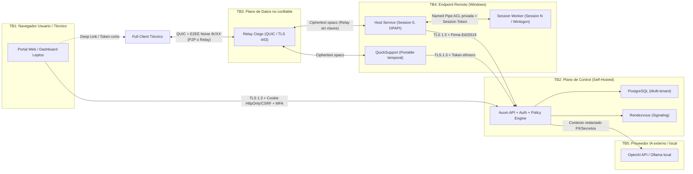

# Modelo de Amenazas y Arquitectura de Seguridad (`docs/security/threat-model.md`)

**Alcance:** Plataforma self-hosted multiempresa en Rust (Control Server + Web Portal + Rendezvous + Relay + Clientes Windows Full/Host/QuickSupport + Copiloto IA).  
**Requisitos vinculados:** `SEC-01` .. `SEC-06`, `AI-03` .. `AI-06`, `SUP-01` .. `SUP-06`, `REL-01` .. `REL-02`.

---

## 1. Fronteras de Confianza (Trust Boundaries)

---

## 2. Matriz de Amenazas Obligatorias (PRD Sección 10)

| ID | Amenaza | Vector de ataque | Controles y Mitigaciones obligatorias | Riesgo residual y verificación |
| :--- | :--- | :--- | :--- | :--- |
| **TH-01** | **Suplantación de técnico** | Un atacante intenta hacerse pasar por soporte legítimo ante el usuario final o secuestrar un ticket de asistencia. | 1) Firma Authenticode del binario QuickSupport + branding verificado del servidor. 2) El técnico reclama el ticket atómicamente en servidor (`POST /tickets/{id}/claim`); el servidor entrega al endpoint la identidad del técnico (nombre, org, clave pública Ed25519 de sesión). 3) En QuickSupport, consentimiento local obligatorio mostrando nombre del técnico y permisos exactos antes de iniciar captura. | Ingeniería social telefónica fuera de banda si el usuario ignora el nombre mostrado; mitigar con código público corto `SUP-XXXX` visible en ambos lados. |
| **TH-02** | **Robo de token / secuestro de sesión** | Robo de cookie web, token de seguimiento `SUP`, deep-link token o credenciales de API. | 1) Cookies `HttpOnly`, `Secure`, `SameSite=Lax/Strict` + protección CSRF. 2) Token de seguimiento público separado de la referencia no secreta, alta entropía (256-bit) y TTL corto. 3) Deep-link tokens de un solo uso y TTL ≤ 60 s. 4) MFA obligatorio (TOTP / WebAuthn passkeys en P1) para técnicos/admins + revocación inmediata en servidor. 5) Secretos de dispositivo cifrados en Windows con **DPAPI (`CryptProtectData`)**. | XSS en frontend mitigado por tipado Rust/Leptos + CSP estricta sin `unsafe-inline`. Malware con privilegios de usuario local en el endpoint puede leer su propia sesión activa. |
| **TH-03** | **Servidor / Relay comprometido** | Un atacante compromete el servidor Relay (o red intermedia) para espiar pantallas, teclado o archivos. | 1) **Relay ciego (`SEC-01`):** El plano de datos usa **Noise IK/XX** (X25519 + ChaCha20-Poly1305 / AES-256-GCM) autenticado con las claves **Ed25519** de técnico y dispositivo. 2) Las claves efímeras de sesión se negocian extremo a extremo; el relay solo reenvía paquetes cifrados opacos. 3) El servidor de control jamás conoce las claves efímeras del stream de video/input. | Si el **Control Server** es comprometido totalmente, podría intentar inyectar una clave pública falsa (MITM en el directorio). Mitigación: *Trust-On-First-Use (TOFU)* / pinning de huella de clave de dispositivo en agenda y verificación visual de SAS/fingerprint. |
| **TH-04** | **Cliente malicioso** | Un cliente modificado envía frames falsos, intenta *path traversal* en transferencia de archivos, o inunda el servidor/relay. | 1) Validación estricta Protobuf/Serde con límites máximos de frame (`max_frame_bytes`). 2) En transferencia de archivos (`ENG-05`), canonicalización estricta de rutas dentro de directorio autorizado + límite de tamaño + verificación SHA-256. 3) Rate limiting por IP, tenant y dispositivo en API, `/support` y relay; cuotas de ancho de banda por sesión. | Ataques de denegación de servicio volumétricos UDP/TCP requieren firewall / DDoS upstream en despliegues expuestos a Internet. |
| **TH-05** | **Fuga multiempresa (Cross-Tenant)** | Técnico de Empresa A intenta listar, buscar o conectar a un dispositivo o ticket de Empresa B manipulando UUIDs o filtros. | 1) **Aislamiento obligatorio en servidor (`SEC-04`):** `tenant_id` obligatorio en todas las tablas multi-tenant, validado en cada middleware/handler por `PolicyEngine`. 2) UUIDv4/v7 no enumerables + verificación de membresía en queries SQLx y filtros de canales SSE/WS. 3) Suite automatizada de **tests negativos cross-tenant** bloqueante en CI. | Error humano al asignar un usuario administrador a múltiples organizaciones; mitigar con auditoría visual clara de tenant activo y confirmación explícita. |
| **TH-06** | **Abuso de acceso desatendido** | Acceso silencioso sin consentimiento o persistencia oculta tras soporte puntual. | 1) QuickSupport **jamás** instala servicio ni deja persistencia al cerrarse (`SUP-06`). 2) Host desatendido requiere enrolamiento administrativo mediante invitación firmada, limitada y revocable (`WEB-03`). 3) Política granular por organización/grupo (requerir confirmación local aunque sea Host, o banner visible obligatorio de sesión activa + botón **Terminar**). 4) Auditoría inmutable append-only UTC de cada inicio/fin/acción. | Compromiso físico o administrativo de un técnico autorizado; mitigar con alertas en tiempo real, MFA y revisión de logs append-only. |
| **TH-07** | **Supply Chain y actualizaciones** | Compromiso de crate Rust, pipeline CI o binario de actualización para distribuir malware a toda la flota. | 1) `Cargo.lock` pineado + `cargo-deny` / `cargo-audit` + generación de SBOM (`cargo-cyclonedx`). 2) Firma Authenticode en HSM/Trusted Signing en CI protegido (`SEC-05`). 3) Manifiestos de actualización firmados con **clave offline Ed25519** verificada por `crates/updater` antes de instalar (`REL-01`, `REL-02`). | Compromiso simultáneo de CI y clave offline; mitigar manteniendo clave de firma de manifiestos separada del entorno de build diario. |
| **TH-08** | **Acciones de IA / Prompt Injection** | Texto malicioso en pantalla, nombre de ventana, log del sistema o cuerpo de ticket intenta instruir al copiloto IA para ejecutar comandos destructivos o exfiltrar secretos. | 1) Tratar toda entrada del endpoint/pantalla/ticket como **datos no confiables** (`PRD §8`). 2) **Redactor PII/Secretos** determinista antes de enviar contexto a LLM externo (`AI-03`). 3) Las herramientas MCP/IA tienen esquemas estrictos y pasan por el **Policy Engine independiente** (`AI-04`). 4) Comandos de terminal, scripts o cambios de sistema requieren aprobación explícita del técnico fuera del contexto del modelo. | Fuga accidental de texto no estructurado en capturas de pantalla si el técnico aprueba explícitamente enviar una imagen a un LLM cloud; mitigar con advertencia visual y opción 100% local (Ollama). |

---

## 3. Política de Secretos y Criptografía (`SEC-01`, `SEC-02`)

- **Prohibida criptografía propia:** Usar exclusivamente `rustls` (TLS 1.3), `snow` (Noise Protocol Framework), `ed25519-dalek` / `x25519-dalek`, `chacha20poly1305` / `aes-gcm`, `argon2` (`Argon2id`) y `rand` (`OsRng`).
- **Almacenamiento en Windows:** Claves privadas de dispositivo y tokens locales cifrados mediante `CryptProtectData` (**DPAPI**) vinculado al usuario o máquina (`LOCAL_MACHINE` con ACL restringida a `SYSTEM` y `Administrators` para el Host Service).
- **Auditoría append-only:** Tabla `audit_events` con `event_id`, `tenant_id`, `actor_id`, `actor_type`, `action`, `resource_type`, `resource_id`, `correlation_id`, `occurred_at_utc`, `outcome`, `metadata_json` (sin secretos), con triggers o permisos SQL que impiden `UPDATE`/`DELETE` por la aplicación.
